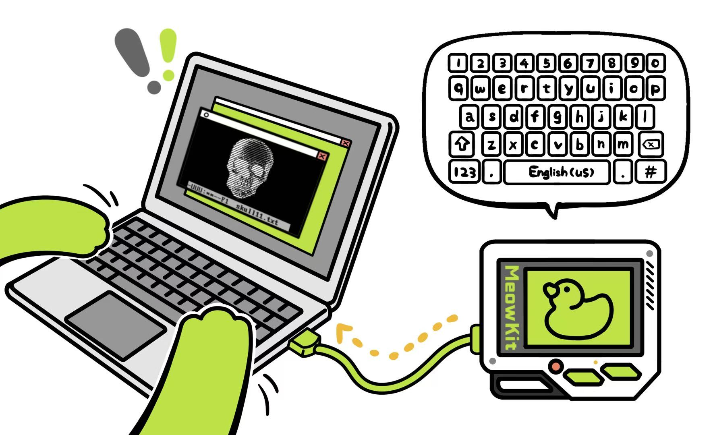
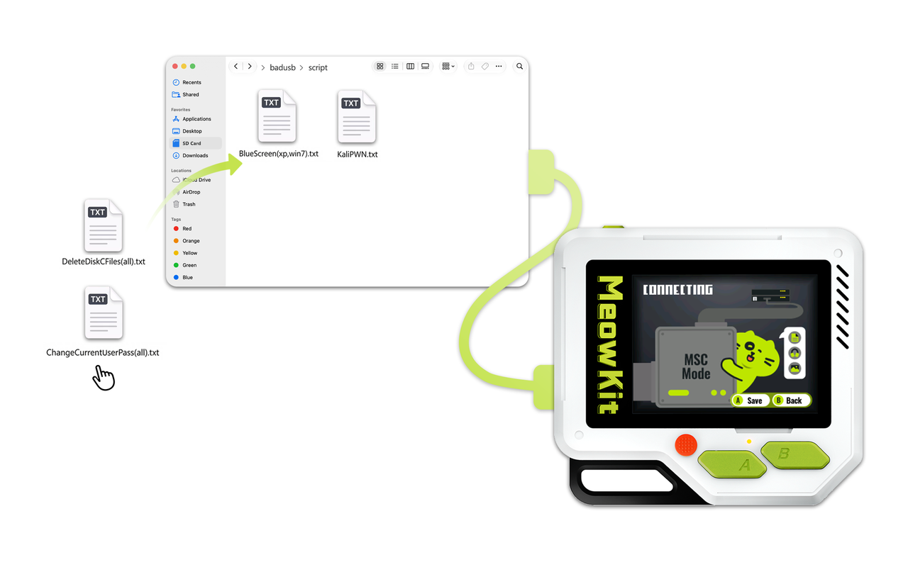
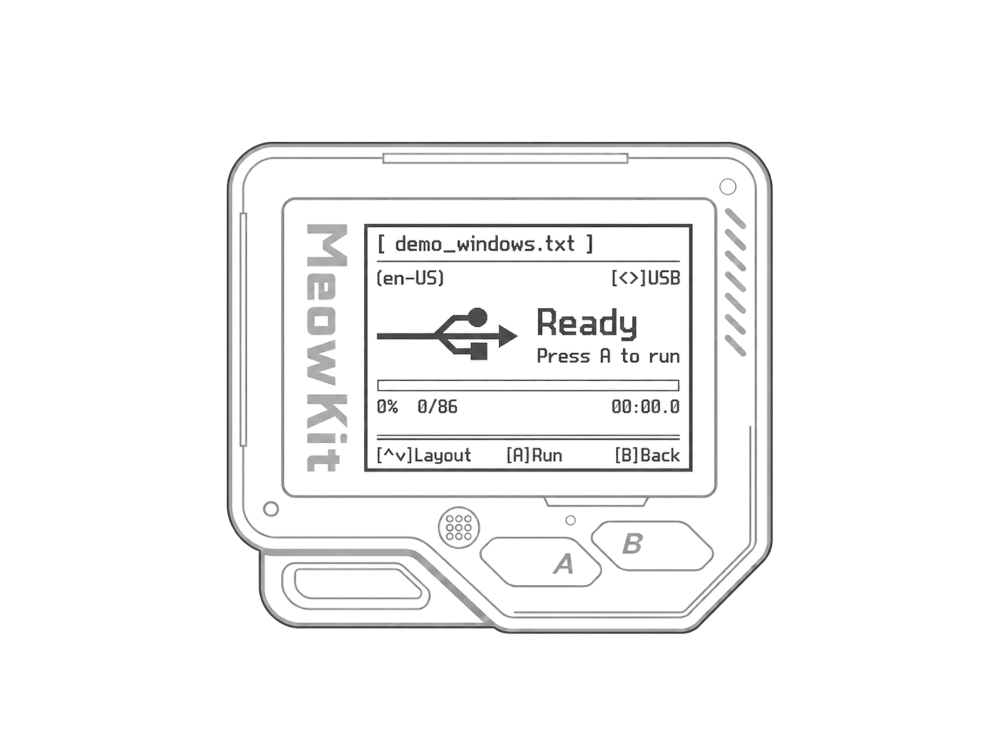
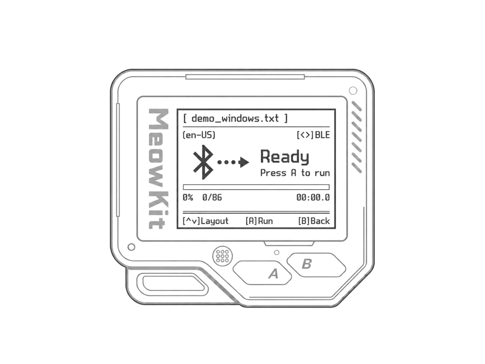

MeowKit can act as a [BadUSB device](https://web.archive.org/web/20220816200129/https://github.com/hak5darren/USB-Rubber-Ducky/wiki/ "BadUSB device"), recognized by computers as a [Human Interface Device](https://en.wikipedia.org/wiki/Human_interface_device "Human Interface Device") (HID), such as a keyboard or even a mouse. A BadUSB device can change system settings, open backdoors, retrieve data, initiate reverse shells, or do basically anything that can be achieved with physical access. It is done by executing a set of commands written in the Rubber Ducky Scripting Language, also known as DuckyScript. This set of commands is also called a payload.

---

# MeowKit scripting language

Create a `.txt` script in a plain-text editor. MeowKit supports common commands from classic DuckyScript 1.0, with additional commands for character input delays, mouse actions, and media controls. Save your scripts to `/badusb/scripts/` on the SD card.

<Warning>
  For syntax and command examples, see the [Flipper Zero BadUSB scripting reference](https://github.com/flipperdevices/flipperzero-firmware/blob/dev/documentation/file_formats/BadUsbScriptFormat.md). When adapting scripts for MeowKit, note these differences:

  - USB and BLE both support keyboard, mouse, media controls, and `.kl` keyboard layouts.
  - `ID`, `BLE_ID`, and `BT_ID` commands are ignored.
  - Text input currently supports ASCII characters only. Full DuckyScript 3.0 support is not available.
</Warning>

---

# Uploading new payloads to MeowKit

After creating your `.txt` script, connect MeowKit to your computer with a USB data cable. Open **USB MSC** in **Settings**, then copy the file to the drive’s `/badusb/scripts/` folder.

Once the transfer is complete, safely eject the drive from your computer. On MeowKit, press **A (Eject)** to end USB MSC mode, then **B (Back)** to return. Reopen **BadUSB** to refresh the script list.

<Danger>
  Copying a file with an existing name may replace the original. Back up scripts you want to keep before confirming replacement.
</Danger>

---

# Using MeowKit as a BadUSB device

## Via USB connection

<Steps>
  <Step title="If **USB MSC** is active, safely eject the drive on your computer, then exit USB MSC mode on MeowKit.">
  </Step>
  <Step title="On MeowKit, open **Applications → BadUSB**.">
  </Step>
  <Step title="In the script list, move the joystick left or right to select **USB**.">
  </Step>
  <Step title="Move the joystick up or down to select a script. Press **A (Enter)** to open its execution page.">
  </Step>
  <Step title="If needed, move the joystick up or down to open **Layout**. Select the keyboard layout used on your computer, then press **A (Apply)**. The default is **en-US**.">
  </Step>
  <Step title="Connect MeowKit to your computer with a USB data cable. Wait for **Ready** on MeowKit.">
  </Step>
  <Step title="Open the target application on your computer and select its input area. Press **A (Run)** on MeowKit to start the script.">
  </Step>
</Steps>

<Warning>
  During execution, press **A** to stop, **B** to stop and return to the script list, or hold **B** to exit the app. Running again starts from the first line.
</Warning>

## Via BLE connection

<Steps>
  <Step title="On MeowKit, open **Settings → Bluetooth** and turn Bluetooth on.">
  </Step>
  <Step title="Open **Applications → BadUSB**.">
  </Step>
  <Step title="In the script list, move the joystick left or right to select **BLE**.">
  </Step>
  <Step title="Select a script and press **A (Enter)**. MeowKit becomes discoverable as **MeowKit BadUSB** when its execution page opens.">
  </Step>
  <Step title="If needed, move the joystick up or down to open **Layout**. Select the keyboard layout used on your computer, then press **A (Apply)**.">
  </Step>
  <Step title="In your computer’s Bluetooth settings, select **MeowKit BadUSB**.">
  </Step>
  <Step title="Complete pairing. If both devices display a six-digit PIN, check that the numbers match, then press **A (Confirm)** on MeowKit and confirm on your computer. If your computer asks you to enter a PIN instead, enter the code shown on MeowKit.">
  </Step>
  <Step title="Wait for **Ready** on MeowKit.">
  </Step>
  <Step title="Open the target application on your computer and select its input area. Press **A (Run)** on MeowKit to start the script.">
  </Step>
</Steps>

---
