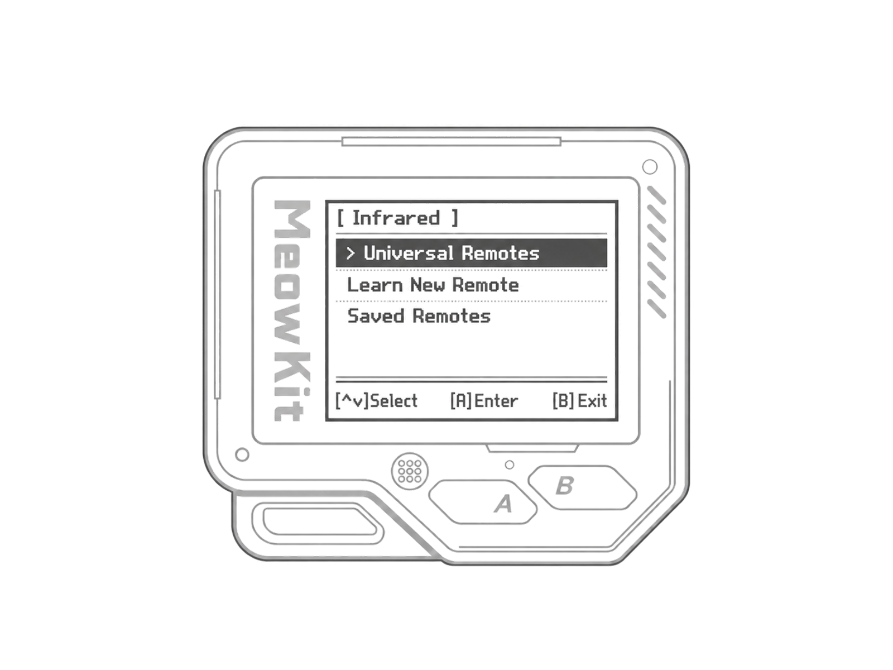
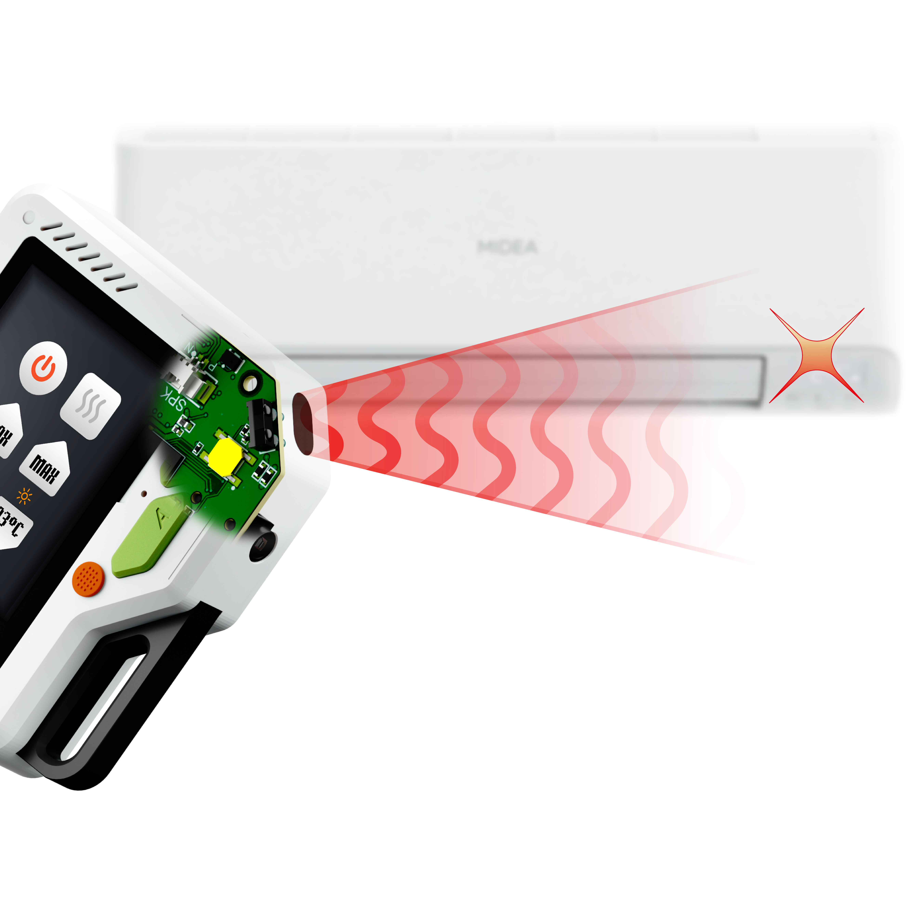

MeowKit can control devices that receive infrared (IR) commands, such as TVs, air conditioners, and audio systems. With its built-in IR module, you can learn and save signals from remote control buttons, or use universal remotes to control supported devices.

<Warning>
  Before you begin, insert a microSD card containing the MeowKit infrared resources. The card stores universal remote libraries and your saved remotes.
</Warning>

---

# Infrared menu

Open **Applications → Infrared** on MeowKit to control devices, learn buttons from a remote, or use your saved remotes.

- **Universal Remotes** — Control devices without the original remote. Choose a device category and a command. MeowKit tries matching signals from the library on your microSD card. Keep it pointed at the device and stop sending when the device responds. Compatibility and scan time depend on the signal library.
- **Learn New Remote** — Capture a button’s signal from your remote and save it on the microSD card. Add more buttons to build your own remote. Each button is learned separately.
- **Saved Remotes** — Open a saved remote and select a button to send its signal. You can also add, rename, reorder, or delete buttons, and rename or delete remotes.

---

# Infrared hardware

The built-in infrared module consists of an infrared-transparent plastic window, two IR LEDs, and an IR receiver.

---

Want to learn more? Check out the following pages:

<Columns cols={2}>
  <Card title="Reading infrared signals" icon="download" href="/infrared/reading-infrared-signals" arrow>
    Capture a remote button, test the signal, and save it for later.
  </Card>
  <Card title="Using universal remotes" icon="satellite-dish" href="/infrared/using-universal-remotes" arrow>
    Load infrared databases and try commands for your device category.
  </Card>
</Columns>
