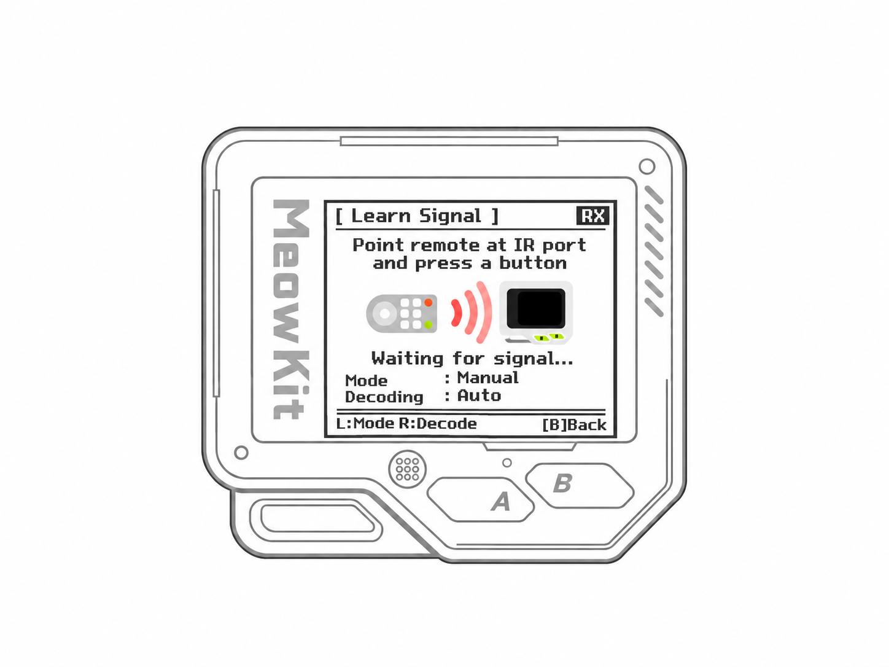
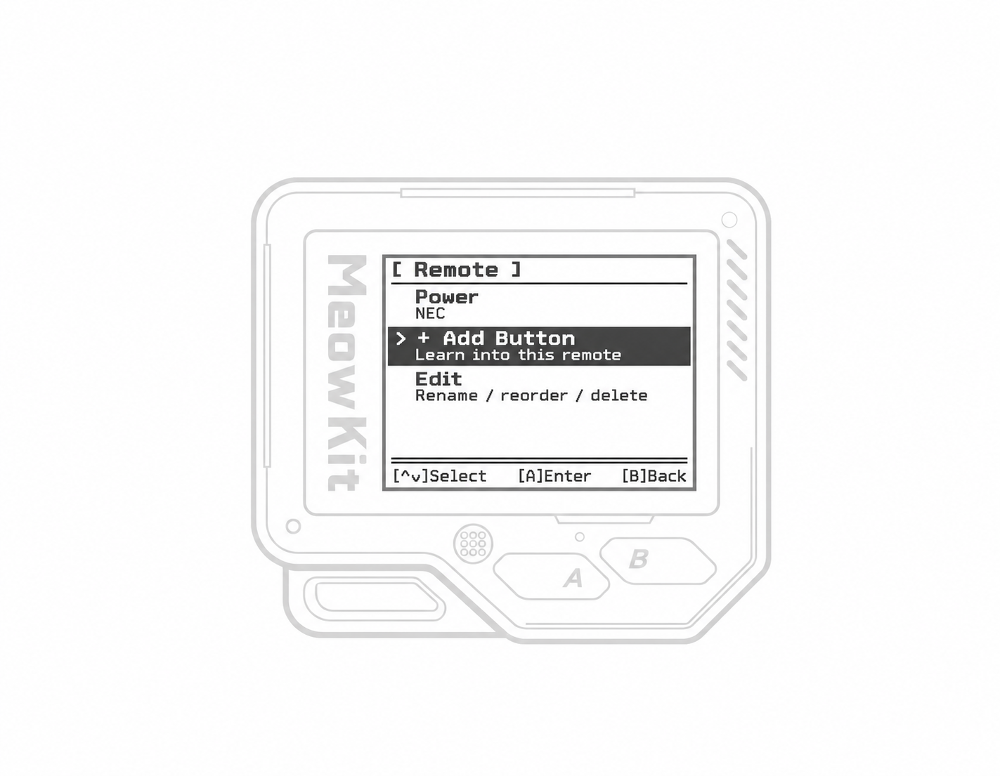
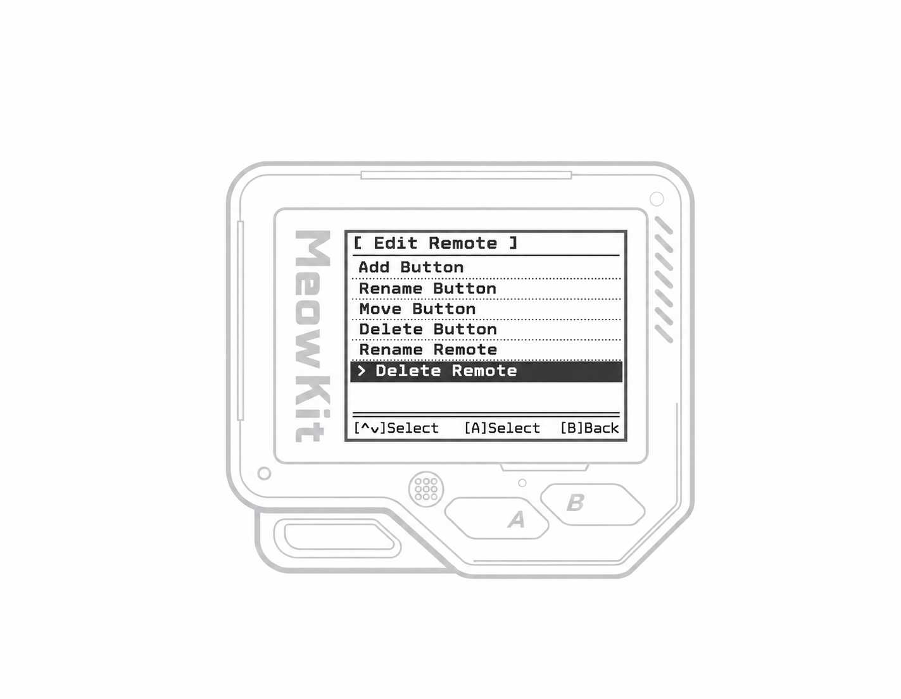

MeowKit can capture and save [infrared](https://en.wikipedia.org/wiki/Infrared) (IR) signals from remote controls used with TVs, air conditioners, projectors, audio systems, and other devices. You can then send the saved signals to control these devices without the original remote.

On this page, you’ll learn how to capture, save, and send IR signals with MeowKit.

---

# Capturing infrared signals

MeowKit uses its built-in IR receiver to capture and demodulate infrared signals with a carrier frequency of 38 kHz. In **Auto** mode, supported protocols are decoded automatically. Unrecognized signals are recorded in **RAW** format.

To capture and save a signal, follow these steps:

<Steps>
  <Step title="Open **Infrared → Learn New Remote**.">
    
  </Step>
  <Step title="Point your IR remote at MeowKit’s IR receiver. Keep the path between them clear.">
  </Step>
  <Step title="On your remote, press the button you want MeowKit to record">
    
  </Step>
  <Step title="Once the signal is captured, MeowKit displays **Signal Received** and the protocol name, or **RAW** if the signal was recorded without decoding.">
  </Step>
  <Step title="To save the signal, press **Right**, name the button, then select **Save** and press **A**.">
  </Step>
  <Step title="After saving the first button, MeowKit creates a virtual remote with the new button. Select **\+ Add Button** to add more buttons.">
    
  </Step>
  <Step title="To customize or delete the virtual remote, select **Edit**.">
    
  </Step>
</Steps>

You can also access and edit saved remotes from **Infrared → Saved Remotes**.

---

# Emulating infrared signals

MeowKit uses its built-in IR transmitter to send saved signals to TVs, air conditioners, projectors, sound systems, and other infrared-controlled devices.

To send a signal, follow these steps:

<Steps>
  <Step title="Open **Infrared → Saved Remotes**.">
  </Step>
  <Step title="Select the saved remote and press **A** to open it.">
  </Step>
  <Step title="Point MeowKit’s IR transmitter at the device you want to control. Keep the path between them clear.">
  </Step>
  <Step title="Select the button you want to send, then press **A**. Hold **A** to send repeatedly.">
  </Step>
</Steps>

---
