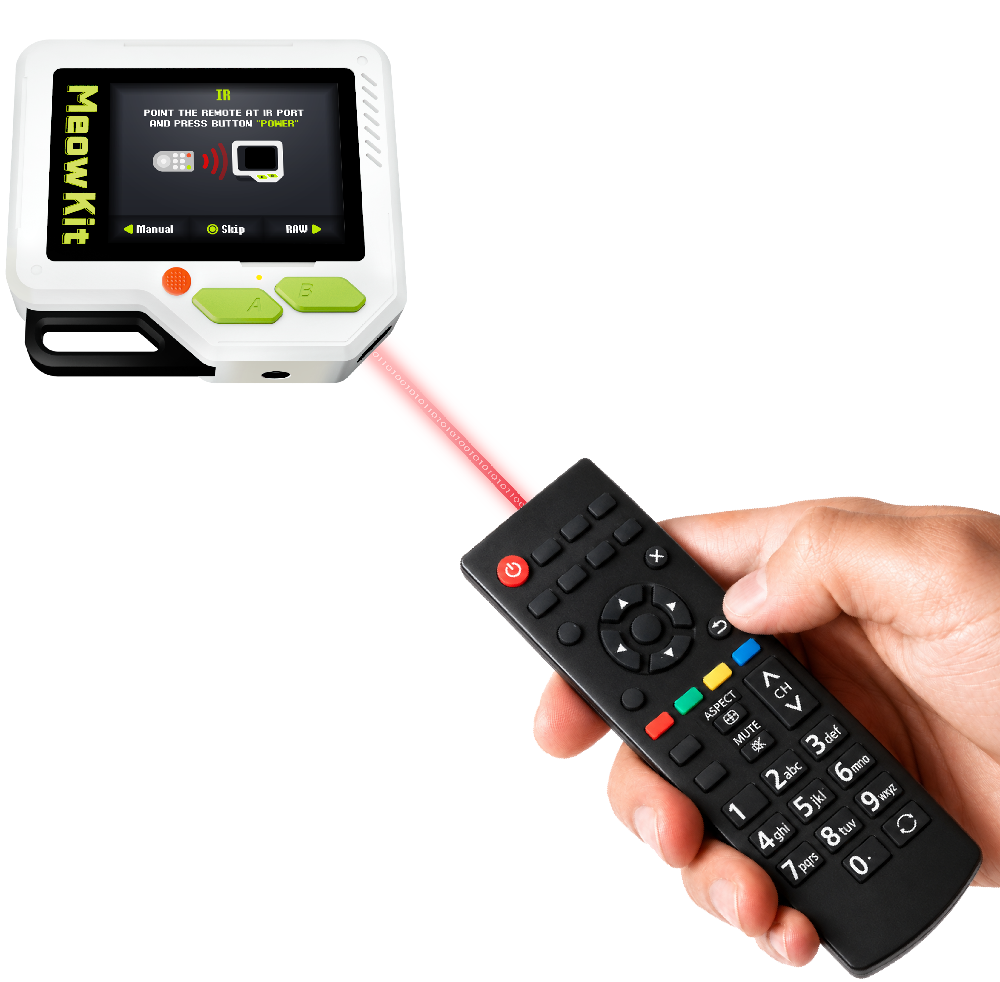

MeowKit can capture and save [infrared](https://en.wikipedia.org/wiki/Infrared) (IR) signals from remote controls used with TVs, air conditioners, projectors, audio systems, and other devices. You can then send the saved signals to control these devices without the original remote.

On this page, you’ll learn how to capture, save, and send IR signals with MeowKit.

---
